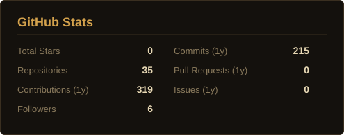
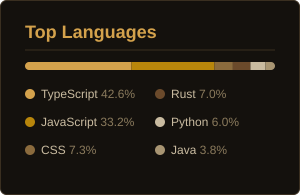
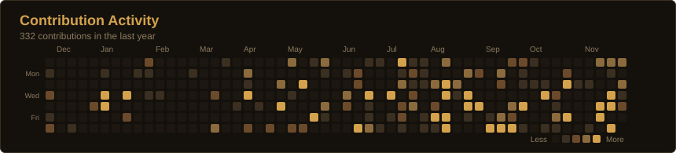

<!-- ===================== HEADER ===================== -->
<div align="center">


<a href="https://github.com/sajidullahkhan08">
  
</a>
 
<br/><br/>

<a href="https://sajidullahkhan.vercel.app"></a>
<a href="https://linkedin.com/in/sajidullah-khan-86142b275"></a>
<a href="mailto:sajiidullahkhan0348@gmail.com"></a>
<a href="https://github.com/sajidullahkhan08"></a>

<br/>


</div>

## whoami

```ts
const sajidullahkhan08: Developer = {
  name:      "Sajidullah Khan",
  role:      "Junior Full-Stack Engineer",
  education: "BS Computer Science @ IIUI (CGPA 3.54, Final Year)",
  location:  "Islamabad, Pakistan",
  currently: "MERN Stack Developer Intern @ 10Pearls (SHINE Program)",
  stack:     ["React", "NestJS", "Node.js", "TypeScript", "PostgreSQL", "MongoDB", "Python", "Kotlin", "Rust"],
  focus:     ["Full-stack systems", "REST APIs", "Auth & Security", "Systems tooling", "DSA & System Design"],
  languages: ["English", "Urdu", "Pashto"],
  mantra:    "Make useful things, then make them delightful.",
};
```

> Final-year CS student who ships. Internships, academic projects and real-world systems have taught me to build **practical, maintainable software**, from full-stack web apps and native Android to Rust and desktop tooling, with a growing focus on backend, systems and problem solving.
>
> Collaborations welcome when they are meaningful.


## Tech Arsenal

<div align="center">

**Languages**<br/>


**Frontend**<br/>


**Backend and APIs**<br/>


**Mobile and Desktop**<br/>


**Databases**<br/>


**Security**<br/>


**Tools and Platforms**<br/>


**Core Strengths**<br/>


</div>


## Featured Projects

<table>
<tr>
<td valign="top" width="50%">

**Plant Process Monitoring Studio for Linux** (Final Year Project)

Open-source, web-native HMI authoring and real-time supervisory runtime for hardened Linux control-room workstations, replacing vendor-locked legacy SCADA. Built with ASCEND Tower NSTP (NUST). Process mimics are stored as W3C SVG 2 with tag bindings, alarm thresholds and scalers; packaged with Tauri for Ubuntu, Fedora and Debian.

    

</td>
<td valign="top" width="50%">

**[Episteme: Spatio-Temporal Atlas of Intellectual History](https://github.com/sajidullahkhan08/episteme)**

Full-stack atlas of about 765 historical figures with a 3D globe and 2D map, timeline, fuzzy search, profiles and relationship networks, built from Wikidata through a cached ingestion pipeline. Zod validation, rate limiting, security headers and Docker deployment.

     

</td>
</tr>
<tr>
<td valign="top" width="50%">

**Kalam & Sophia: Philosophy & Theology Publication Platform**

Academic publishing platform with a public reading site and an authoring studio: citation engine (APA, Chicago, Harvard, BibTeX), KaTeX math, reading mode, and PostgreSQL Row Level Security with security-definer functions.

    

</td>
<td valign="top" width="50%">

**SmartKabari: Digital Scrap Collection & Marketplace**

Native Android app connecting households with scrap collectors and recyclers: reference prices, scheduled pickups, verified collectors, digital receipts and a bulk marketplace. MVVM and Clean Architecture, Firestore, Cloud Functions and FCM.

   

</td>
</tr>
<tr>
<td valign="top" width="50%">

**[DevForge: Developer Environment Manager](https://github.com/sajidullahkhan08/DevForge)**

Windows desktop app that installs, verifies, configures, updates and removes developer tools from a validated catalogue, with dependency planning, a serialized install queue, checksum verification and typed, validated IPC.

   

</td>
<td valign="top" width="50%">

**[Green Hilton Hotel Management System](https://github.com/sajidullahkhan08/green-hilton-hotel)**

Hotel booking platform with separate customer and staff portals, role-based access, booking workflows, dashboards and Cloudinary media management.

  

</td>
</tr>
</table>

<sub>Also: <a href="https://github.com/sajidullahkhan08/Task-Management-System"><b>Task Management System</b></a> (MERN), <a href="https://github.com/sajidullahkhan08/Electronic-Appliance-Repair-Service-and-Management-System"><b>ElectroFix</b></a> (Flask), <a href="https://github.com/sajidullahkhan08/Sortify"><b>Sortify</b></a> (Java/JavaFX), <a href="https://github.com/sajidullahkhan08/CSV-Anonymizer"><b>CSV Anonymizer</b></a> (Python), <a href="https://github.com/sajidullahkhan08/snake-ai-RL"><b>Snake AI</b></a> (PyTorch Deep Q-Learning), <a href="https://github.com/sajidullahkhan08/Neon-Hex---The-Alpha-Beta-Duel"><b>Neon Hex</b></a> (Minimax + alpha-beta), <a href="https://github.com/sajidullahkhan08/Snake-Game"><b>Snake Game</b></a> (C++/Raylib) &middot; <a href="https://github.com/sajidullahkhan08?tab=repositories">all repositories</a></sub>


## Experience

| Period | Role | What I built |
| :-- | :-- | :-- |
| **10/2026 to Now** | **MERN Stack Developer Intern**<br/>`10Pearls Pakistan` (SHINE Internship Program) | Building a full-stack web application end to end with MongoDB, Express, React and Node.js in a structured, industry-style environment with mentorship, code reviews and professional engineering practices |
| **06/2026 to 10/2026** | **Full Stack AI Engineering Fellow**<br/>`DevWeekends` &middot; Remote | Completed an intensive fellowship covering full-stack development, data structures and algorithms, LeetCode patterns, system design and industry engineering practices |
| **07/2026 to 08/2026** | **Web Developer Intern**<br/>`TEEROP SMC Private Limited` | **POS & Inventory** and **Vehicle Rental** management systems with multi-role workflows (React, Node.js, Express, PostgreSQL, Sequelize, JWT, Supabase), role-based dashboards, validation, security middleware, deployed on Railway and Vercel |
| **05/2025 to 06/2026** | **Full Stack / Backend Developer Intern**<br/>`DevelopersHub Corporation` | Task Management System (auth, CRUD, filtering and search, sharing, real-time notifications), an Alibaba-style e-commerce platform, **Nexus** (entrepreneur-investor platform), plus an e-commerce backend and Bookstore REST API |

<details>
<summary><b>Earlier experience</b></summary>

| Period | Role | What I built |
| :-- | :-- | :-- |
| **08/2026 to 09/2026** | **Appian Developer Intern**<br/>`Software Productivity Strategists (SPS)` | **Account Opening Management**, a role-based banking workflow with Data Fabric, SAIL, process models, SLA automation, audit trails and REST integrations |
| **06/2026 to 07/2026** | **Backend Development Virtual Intern**<br/>`DecodeLabs` &middot; Remote | REST APIs, JWT auth, OpenWeatherMap integration, caching, rate limiting and circuit-breaker logic |
| **06/2025 to 08/2025** | **Full Stack Developer Intern**<br/>`Arch Technologies` | Four MERN apps: CMS portfolio, music streaming, social network and task manager (GridFS, Socket.IO) |

</details>


## Education and Certifications

<table>
<tr>
<td width="50%" valign="top">

**Education**

- **BS Computer Science**, International Islamic University Islamabad<br/>`2023 to Present` &middot; CGPA **3.54**<br/>**Final Year Project:** Plant Process Monitoring Studio for Linux (with ASCEND Tower NSTP, NUST)
- **FSc Pre-Engineering**, Punjab College of Science<br/>`2018 to 2020` &middot; A-1 (86%)
- **Matriculation**, GCMHS Alpuri, Shangla<br/>`2016 to 2018` &middot; A-1 (87%)

</td>
<td width="50%" valign="top">

**Certifications**

- **CS50x**: Introduction to Computer Science (Harvard)
- **CS50 Web**: Programming with Python and JavaScript (Harvard)
- **CS50 Introduction to Databases with SQL** (Harvard)
- **Meta Front-End Developer** Specialization (Coursera)
- **Meta Back-End Developer** Specialization (Coursera)

</td>
</tr>
</table>


## GitHub Stats

<div align="center">







</div>


## Beyond the Code

- **Profile:** MERN, NestJS, PostgreSQL, TypeScript, Python and Java, plus native Android (Kotlin), Rust desktop tooling and AI work
- **Experience:** six internships and a full-stack fellowship across web, backend and enterprise workflow development
- **Systems and security:** SVG-first industrial HMI tooling, Row Level Security, validated IPC and hardened deployment practices
- **Problem solving:** DSA, LeetCode patterns, system design, Minimax/alpha-beta and Deep Q-Learning projects
- **AI-native development:** trained on the AI-Native Software Development Life Cycle (AI-Native SDLC Playbook by Claude)
- **Off-screen:** philosophy, history and theology; cricket, football and video games
- **Open to:** internships, junior roles, meaningful collaborations and useful products


<div align="center">

## Let's Build Something Meaningful

*I build useful software and enjoy turning ambitious ideas into working products.*

<a href="mailto:sajiidullahkhan0348@gmail.com"></a>
<a href="https://sajidullahkhan.vercel.app"></a>

<br/>

<sub>From <a href="https://github.com/sajidullahkhan08">Sajidullah Khan</a> &middot; built with code, coffee and a little chaos</sub>


</div>
